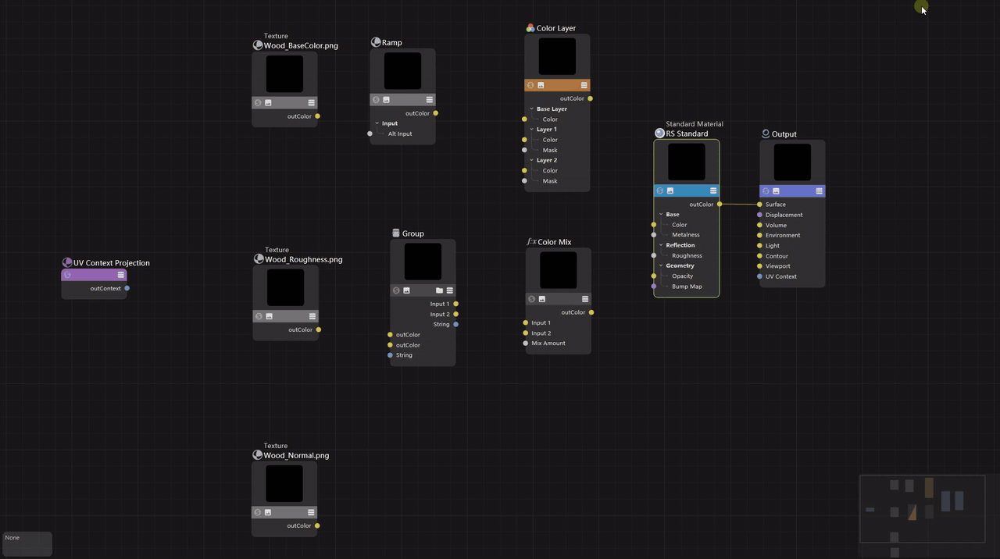

# NodeStroke for Cinema 4D 2027

English | [简体中文](README.zh-CN.md)

NodeStroke lets you connect, cut and tidy wires in the Cinema 4D node editor by drawing strokes while holding a key. It is a C++ SDK plugin for Cinema 4D 2027.0 on Windows (Redshift node materials).



[Watch the demo as MP4](docs/media/demo.mp4)

Download: see [Releases](../../releases). Full instructions: **[User Guide](docs/usage.md)**.

## Features

With the mouse over the node editor canvas:

- **Hold I and move the mouse**: connects the nodes or ports you pass, in order. Drawing from port to port picks exact ports.
- **Hold Y and move the mouse**: cuts the wires you cross.
- **Drag a node and shake it left and right**: takes it out of its wires and joins upstream to downstream.
- **Drag an unconnected node onto a wire and rest briefly**: inserts it into the wire.

Strokes apply when the key is released, and every change can be undone with Ctrl+Z. Node groups and group interface ports are supported. Connecting to a material's bump input or the Output's displacement input adds a Bump Map / Displacement node automatically.

## Settings

**Edit > Preferences > NodeStroke**: turn single gestures on or off, edit the connection rules, and turn on the diagnostic log (off by default; when on, the reason a gesture did not act is written to `nodestroke_debug.txt` in the preferences folder). Settings are saved with the Cinema 4D preferences. The interface follows the Cinema 4D language (English / Simplified Chinese).

## Commands

These commands are not in the Extensions menu. Find them in the Commander or give them a shortcut in Customize Commands. Select the node material in the Material Manager first, then select the elements in the node graph.

| Command | Use |
| --- | --- |
| `NodeStroke: Disconnect Selected Nodes` | Removes every wire of the selected nodes |
| `NodeStroke: Cut Selected Wires` | Removes the selected wires |
| `NodeStroke: Extract Selected Nodes` | Takes the selected nodes out of their wires and joins upstream to downstream |
| `NodeStroke: Connect Selected Ports` | Connects one selected output port to one selected input port, replacing an existing wire on the input |
| `NodeStroke: Chain Connect Selected Nodes` | Connects the selected nodes left to right, choosing ports automatically |
| `NodeStroke: Fan Out From Leftmost Node` | Connects the leftmost node to every other selected node |
| `NodeStroke: Fan In To Rightmost Node` | Connects the other nodes into free inputs of the rightmost node |
| `NodeStroke: Insert Node Into Selected Wire` | Select a wire and a node, or the two nodes a wire joins plus the node to insert |
| `NodeStroke: Add Rule From Selected Ports` | Connects a selected port pair and remembers it as the default for these two node types |
| `NodeStroke: Edit Connection Rules` | Rules window: list, add from selected ports and delete rules (stored in `<preferences folder>/nodestroke_rules.txt`) |
| `NodeStroke: Toggle Canvas Gestures` | The same switch as "Enable Gestures" in the preferences |

Ports are chosen in this order: custom rules, then a free input of the same type family (such as col3/col4), then any free connectable input, then replacing an occupied input (fan in never replaces). Ports are tried in the order the node editor shows them. Every change runs in one graph transaction and can be undone.

## How it works

The node editor has no public API for canvas coordinates. The canvas gestures read the node editor's own view records and drawing data (read-only) to locate nodes and ports. This is tuned for Cinema 4D 2027.0 and checked against module SHA-256 hashes; on any other build, exact positions and group interface support turn themselves off, and the canvas must be scrolled once before gestures work. Investigation notes (in Chinese) are in `docs/investigation.md`.

The plugin IDs 1072547–1072560 are registered with Maxon.

## Building

You need the Cinema 4D 2027.0.0 C++ SDK (unpacked to `sdk/` in the repository root, not tracked by Git), CMake, Visual Studio 2022 and the Windows SDK:

```powershell
cmake -S sdk -B build-c4d -G "Visual Studio 17 2022" -A x64 -DMAXON_SDK_MODULES_DIR=<repository path>/c4d_plugin
cmake --build build-c4d --config Release --target nodestroke --parallel 8
```

Output: `build-c4d/bin/Release/plugins/nodestroke/nodestroke.xdl64`. Copy it together with the `res` folder next to it into a `NodeStroke` folder in the Cinema 4D 2027 user plugins folder, then restart Cinema 4D. A loaded DLL is locked, but it can be renamed before copying the new one.

Package: `powershell -ExecutionPolicy Bypass -File tools/package.ps1` creates `dist/NodeStroke/` and `dist/NodeStroke.zip`, including the user `README.txt` from `docs/package/README.txt`. The preferences description and all interface strings are generated into `c4d_plugin/nodestroke/res` by `python tools/make_res.py`.

Standalone model tests (`src/`, `tests/`, no SDK needed):

```powershell
cmake -S . -B build -G "Visual Studio 17 2022" -A x64
cmake --build build --config Debug
ctest --test-dir build -C Debug --output-on-failure
```

`experiments/` holds read-only research probes and is not part of the plugin build.
