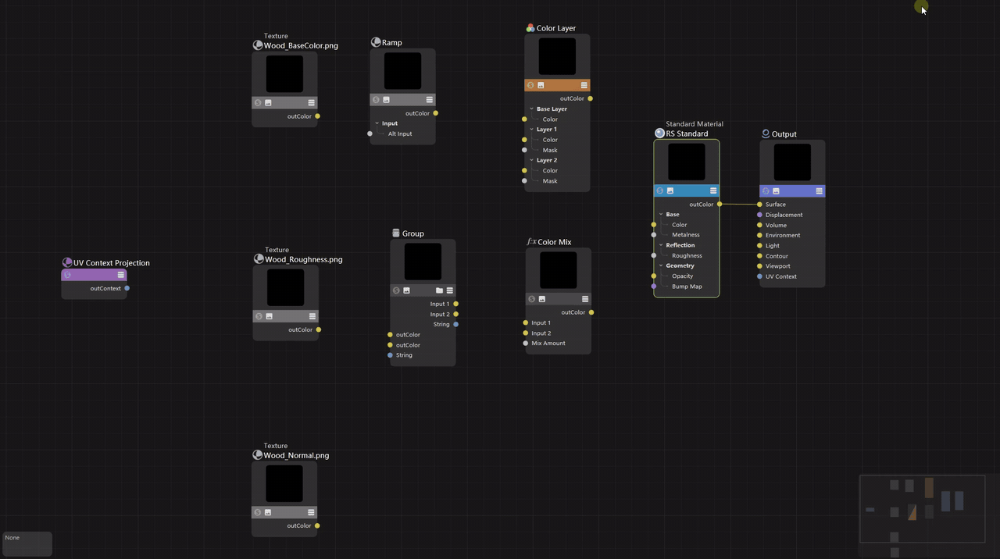

# NodeStroke for Cinema 4D

English | [简体中文](README.zh-CN.md)

NodeStroke lets you connect, cut and tidy wires in the Cinema 4D node editor by drawing strokes while holding a key. It is a C++ SDK plugin for Redshift node materials on Windows.

| Cinema 4D | Status |
| --- | --- |
| 2027+ | Supported |
| 2026+ | Supported. Scroll the canvas once before the first stroke. Before 2026.4.0, positions are estimated and wires to a group's interface ports cannot be connected or cut |



[Watch the demo as MP4](docs/media/demo.mp4) · Download: [Releases](../../releases) · Full instructions: **[User Guide](docs/usage.md)**

## Features

With the mouse over the node editor canvas:

- **Hold I and move the mouse**: connects the nodes or ports you pass, in order.
- **Hold Y and move the mouse**: cuts the wires you cross.
- **Drag a node and shake it**: takes it out of its wires and joins upstream to downstream.
- **Drag an unconnected node onto a wire and rest briefly**: inserts it into the wire.

Strokes apply when you release the key, and Ctrl+Z undoes them. They work inside node groups and with group interface ports. Connecting to a bump or displacement input adds the Bump Map or Displacement node for you.

**Extensions > NodeStroke** turns the gestures on or off (shown checked when on) and opens the settings. More commands, such as Chain Connect and Fan Out, are in the Commander. Settings are under **Edit > Preferences > NodeStroke**. The interface follows the Cinema 4D language (English / Simplified Chinese).

## How it works

The node editor has no public API for canvas coordinates. NodeStroke reads the node editor's own view records and drawing data (read-only) to locate nodes and ports. This is tuned for 2027.0 and 2026.4.0 and checked against module SHA-256 hashes. On any other build, exact positions and group interface ports turn themselves off, and the canvas must be scrolled once before strokes work. Investigation notes (in Chinese) are in `docs/investigation.md`, and the 2026 details in [Cinema 4D 2026 compatibility](docs/compatibility-2026.md).

The plugin IDs 1072547–1072560 and 1073003 are registered with Maxon.

## Building

You need CMake, Visual Studio 2022 and the Windows SDK, plus the Cinema 4D C++ SDKs unpacked in the repository root (not tracked by Git): the 2027.0.0 SDK in `sdk/` and the 2026.0.0 SDK in `sdk-2026.0.0/`. Then run:

```powershell
powershell -ExecutionPolicy Bypass -File tools/build-release.ps1
```

The script builds 2027 and 2026 and creates `dist/NodeStroke-C4D2027.zip` and `dist/NodeStroke-C4D2026.zip`, each holding one `NodeStroke` folder. Use `-Versions 2026` to build one version and `-SkipBuild` to package the existing builds. It checks each SDK's version, keeps a separate build folder per version (`build-c4d/`, `build-c4d-2026.0.0/`), and renames a PDB that a running Cinema 4D has locked. For 2026 details, see [Cinema 4D 2026 compatibility](docs/compatibility-2026.md#building).

Interface strings and the preferences description are generated into `c4d_plugin/nodestroke/res` by `python tools/make_res.py`.

**Tests** (`src/`, `tests/`, no SDK needed):

```powershell
cmake -S . -B build -G "Visual Studio 17 2022" -A x64
cmake --build build --config Debug
ctest --test-dir build -C Debug --output-on-failure
```

`experiments/` holds read-only research probes and is not part of the plugin build.
