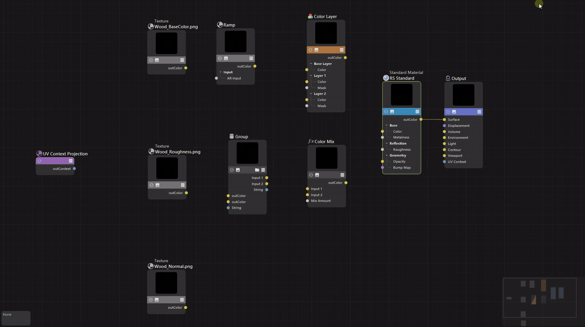

# NodeStroke for Cinema 4D

[English](README.md) | 简体中文

NodeStroke 让你在 Cinema 4D 节点编辑器里按住一个键划线，来连接、切断和整理连线。它是 Windows 上用于 Redshift 节点材质的 C++ SDK 插件。

| Cinema 4D | 状态 |
| --- | --- |
| 2027+ | 支持 |
| 2026+ | 支持。第一次划线前需先滚动一次画布。2026.4.0 之前的版本位置为估算，连到组接口端口的连线无法连接或切断 |



[观看 MP4 版演示](docs/media/demo.mp4) · 下载：[Releases](../../releases) · 完整说明：**[使用文档](docs/usage.zh-CN.md)**

## 功能

鼠标放在节点编辑器画布上：

- **按住 I 并移动鼠标**：按顺序连接划过的节点或端口。
- **按住 Y 并移动鼠标**：切断划过的连线。
- **拖动节点并左右摇晃**：把节点从连线中摘出，上下游自动接上。
- **把没有连线的节点拖到连线上停一下**：插入到这根线中。

松开按键时执行，Ctrl+Z 可撤销。节点组内和组接口端口都能用。连到凹凸或置换输入时，会自动添加 Bump Map 或 Displacement 节点。

**扩展 > NodeStroke** 可以开关手势（开启时显示勾选）并打开设置。依次连接、分发等更多命令在命令管理器（Commander）里。设置位于 **编辑 > 设置 > NodeStroke**。界面跟随 C4D 界面语言（简体中文 / 英文）。

## 实现说明

节点编辑器没有公开画布坐标的 API。NodeStroke 读取节点编辑器自身的视图记录与绘制数据（只读）来确定节点和端口位置。这部分按 2027.0 和 2026.4.0 调校，并用模块 SHA-256 校验版本；其他版本上精确定位与组接口端口自动停用，需先滚动一次画布再划线。调查记录见 `docs/investigation.md`，2026 的细节见 [Cinema 4D 2026 适配](docs/compatibility-2026.zh-CN.md)。

插件 ID 1072547–1072560 和 1073003 已在 Maxon 注册。

## 构建

需要 CMake、Visual Studio 2022、Windows SDK，以及解压到仓库根目录的 Cinema 4D C++ SDK（不纳入 Git）：2027.0.0 SDK 放到 `sdk/`，2026.0.0 SDK 放到 `sdk-2026.0.0/`。然后运行：

```powershell
powershell -ExecutionPolicy Bypass -File tools/build-release.ps1
```

脚本依次构建 2027 和 2026，并生成 `dist/NodeStroke-C4D2027.zip` 和 `dist/NodeStroke-C4D2026.zip`，每个包里都是一个 `NodeStroke` 文件夹。`-Versions 2026` 只构建一个版本，`-SkipBuild` 只打包现有构建。脚本会校验 SDK 版本，每个版本使用独立的构建目录（`build-c4d/`、`build-c4d-2026.0.0/`），C4D 运行时被锁定的 PDB 会先改名。2026 的细节见 [Cinema 4D 2026 适配](docs/compatibility-2026.zh-CN.md#构建)。

界面字符串和设置页描述由 `python tools/make_res.py` 生成到 `c4d_plugin/nodestroke/res`。

**测试**（`src/`、`tests/`，不依赖 SDK）：

```powershell
cmake -S . -B build -G "Visual Studio 17 2022" -A x64
cmake --build build --config Debug
ctest --test-dir build -C Debug --output-on-failure
```

`experiments/` 中是研发用的只读探针，不参与插件构建。
